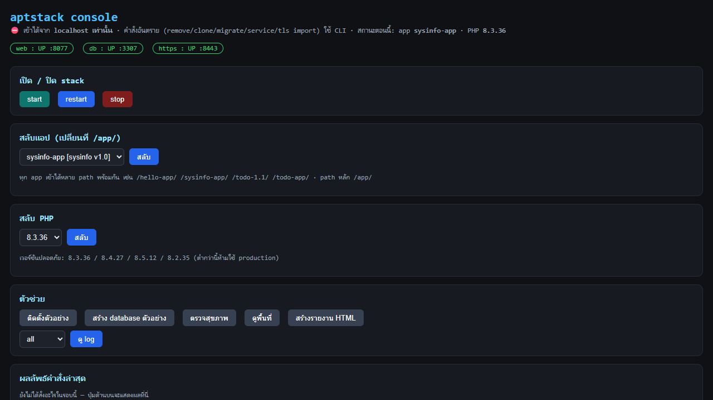

# aptstack

Portable **PHP + MariaDB + app-version manager** for Windows. No installer, no registry —
one folder you can copy to a server, run as a **Windows Service**, and switch versions with one command.

Inspired by [Laragon](https://laragon.org/) / XAMPP, and by the `devstack` tool — but adds two things
devstack does not have: **app-version switching** and **Windows Service install**.

> **ภาษาไทย:** 🚀 **[Scenario — extract to running](docs/SCENARIO.md)** ·
> [README-TH.md](README-TH.md) · คู่มือใช้งาน [docs/คู่มือ.md](docs/คู่มือ.md) ·
> [docs/คู่มือ.html](docs/คู่มือ.html) · [offline/air-gapped](docs/OFFLINE-DEPLOY.md) ·
> เทียบกับ devstack [docs/เปรียบเทียบ-devstack.md](docs/เปรียบเทียบ-devstack.md) ·
> credits + ความเห็นต่อโปรเจกต์ [docs/ABOUT-TH.md](docs/ABOUT-TH.md) ·
> diagrams (SVG+Mermaid) [docs/diagrams.md](docs/diagrams.md) ·`r`n> project timeline [apphistory.md](apphistory.md) ·
> deep dives: [review](review.md) (bugs found & fixed) · [audit](audit.md) (security) ·
> [concept](concept.md) (architecture) · [soul](soul.md) (philosophy) · [ai](ai.md) (for AI agents)

---

## Why

- **Copy-to-deploy.** Every absolute path inside the bundle is regenerated at start
  → copy the folder to another machine and it just works.
- **Switch versions safely.** App code lives in `versions\<ver>` and the live docroot is a junction.
  Switching = repoint the junction + restart. Old version stays on disk → instant rollback.
- **Security by default.** `aptstack doctor` checks against the PHP RCE advisory
  (`8.5.12 / 8.4.27 / 8.3.36 / 8.2.35` minimum; `≤8.1` is EOL) and confirms hardening is applied.

## Quick start

```cmd
cd /d D:\aptstack
aptstack init            :: structure + installs the 3 sample apps when versions\ is empty
aptstack list            :: what's installed (full paths + download source per binary)
aptstack seed            :: sample database (greetings + todo_items)
aptstack start           :: database + web  (real health probes, not blind sleeps)
aptstack doctor          :: security / health check
```

Open <http://127.0.0.1:8077/app/> and switch between the samples:

```cmd
aptstack use todo-app     :: real CRUD app backed by MySQL
aptstack use sysinfo-app  :: machine inventory (IPv4/subnet/CPU/RAM/disk)
aptstack next | prev      :: cycle · aptstack use - = rollback
```

| Sample | Proves |
|---|---|
| `hello-app` | web + PHP + DB connected (`greetings` table) |
| `todo-app` | **real database usage** (inserts into `todo_items`) |
| `sysinfo-app` | reads IP/subnet/CPU/RAM/disk of the host it runs on |

> **Everything lives inside the extracted folder** — `stack\`, `versions\`, `config\`,
> **`data\`**, `logs\`. Nothing is written outside it (only `stack\` needs binaries added first).

> **Offline / air-gapped servers:** `aptstack add` accepts a **local path**, so you can
> download the PHP/Apache/MariaDB zips on another machine, copy them over (USB / share / RDP),
> then run `aptstack add php D:\staging\php-8.3.36-Win32-vs16-x64.zip` with no internet access.
> You may also drop files straight into `stack\php\<ver>\`, `stack\apache\<name>\`,
> `stack\mysql\<name>\`. Full checklist (checksums, VC++ runtime, manual drop-in,
> internal mirror URLs) → **[docs/OFFLINE-DEPLOY.md](docs/OFFLINE-DEPLOY.md)**

```cmd
:: add + switch app version
aptstack add app C:\deploy\myapp-1.2.0.zip
aptstack use 1.2.0
aptstack use -            :: rollback

:: add + switch PHP
aptstack add php C:\Downloads\php-8.3.36-Win32-vs16-x64.zip
aptstack use php 8.3.36

:: run as a Windows Service (needs admin)
aptstack service install
aptstack service start
```

## Layout

```
aptstack\
├── aptstack.cmd / as.cmd     entry points
├── aptstack.ps1              all logic
├── setup.ps1                 first-run wizard
├── service.ps1               Windows Service install/uninstall
├── service\AptStackService.cs  service host source (compiled by service.ps1)
├── templates\                <- EDIT THESE (php.ini, my.ini, extensions, hardening)
├── config\                   <- ONE config folder (gitignored)
│   ├── stack.json              version + port + httpsEnabled (the file you edit)
│   ├── vhosts.json             virtual hosts (edit, then restart)
│   ├── certs\                  TLS cert/key (aptstack tls init | tls import)
│   ├── php.ini / my.ini / httpd.conf   generated — do not edit
│   └── pids\, tmp\, stop.flag
├── stack\                    binaries (gitignored)
│   ├── php\8.3.36\, php\8.1.34\
│   ├── apache\httpd-2.4.69\
│   └── mysql\mariadb-11.4.13-winx64\
├── versions\                 app source code (gitignored)  versions\1.0.0\, 1.1.0\
├── data\                     database (gitignored)  datadir per engine + dumps\
├── www\                      docroot: router.php + phpmyadmin + junction -> versions\<active>
├── logs\  downloads\  bin\
└── docs\                     manuals
```

### `versions\` vs `www\` vs `app`

- **`versions\`** — every app version lives here, always: `versions\<name>\`.
  One version and ten versions use the *same* folder shape; adding one never moves anything.
- **`www\`** — the real document root the web server points at (`php -S … -t www`,
  Apache `DocumentRoot`). It holds only `index.php`, `router.php`, `phpmyadmin\` and the
  junction below — **never app source code**.
- **`app`** — not a folder. It is the value of `appAlias` in `config\stack.json`
  (default `app`): the *name* of the junction inside `www\`, hence the URL path
  `http://127.0.0.1:8077/app/`.

Switching versions only re-points the junction (`www\app -> versions\<active>`); the old
version stays on disk, so `aptstack use -` rolls back instantly.

**Rule of thumb:** `templates\` = permanent source · `config\` = generated values ·
`stack\` = binaries · `versions\` = code · `data\` = database.

Only `templates\`, scripts and docs are committed to git — binaries, app code and database dumps
are ignored on purpose (this repo is public).

## Commands

| Command | What it does |
|---|---|
| `aptstack init` | create structure (installs sample apps if `versions\` is empty) |
| `aptstack samples` | install all sample apps (`hello` / `todo` / `sysinfo`) |
| `aptstack add app <folder\|zip> [name]` | add app version → `versions\<name>` (name is free-form) |
| `aptstack add php 8.3.36` | build official URL, download + install (also accepts `latest`) |
| `aptstack add php <zip\|url>` | or pass your own URL/path |
| `aptstack list` | installed versions + active one |
| `aptstack use <ver>` | switch app version (+ auto restart) |
| `aptstack use php <ver>` | switch PHP (+ auto restart) |
| `aptstack use` | menu (pick by number) |
| `aptstack use -` | rollback to previous version |
| `aptstack next` / `prev` | cycle app versions |
| `aptstack start` / `stop` / `restart` | stack lifecycle |
| `aptstack status` | running? which version? |
| `aptstack doctor` | security + health check |
| `aptstack backup [file]` | dump all databases → `data\dumps\` |
| `aptstack seed` | import sample database (`aptstack_demo`) |
| `aptstack logs <apache\|mysql\|php\|all> [n]` | tail log files, highlight errors |
| `aptstack tls status\|init\|import\|off` | HTTPS — self-signed **or real cert** |
| `aptstack report` | printable HTML status report (checks + probes + **folder sizes / bloat warnings**) |
| `aptstack size` | CLI size table — every folder, per-version breakdown, disk-free warnings |
| `aptstack run` | dev console: start + block on screen, Ctrl+C stops (**no service needed**) |
| `aptstack dist <app> [out] [nostack]` | build copy-paste deploy bundle (`VERSIONS.txt` + `DEPLOY.txt`) |
| `aptstack git init\|status\|clear` | optional git for the bundle on the server |
| `aptstack clone app <from> <to>` | copy app code (does not switch; **same DB**) |
| `aptstack clone mysql <from> <to>` | copy a datadir (requires `stop` + confirm) |
| `aptstack remove app\|php\|apache\|mysql <name> [data]` | delete with warnings + confirmation |
| `aptstack migrate mysql <new>` | move data to another engine (dump → restore) |
| `aptstack help` / `-h` / `--help` | show all commands (via `aptstack.cmd`) |
| `aptstack service install` | Windows Service (admin) |

## Ports

| Service | Default | Change in |
|---|---|---|
| Web (Apache mod_php / PHP built-in) | `8077` | `config\stack.json` → `httpPort` |
| HTTPS (Apache only) | `8443` | `config\stack.json` → `httpsPort` |
| MariaDB | `3307` | `config\stack.json` → `dbPort` |

Want to keep using **XAMPP's MySQL** instead of the bundled MariaDB?
Set `"dbMode": "external"` and `"dbPort": 3306` in `config\stack.json` — aptstack will neither
start nor stop that MySQL (see [คู่มือ.md](docs/คู่มือ.md)).

## HTTPS & virtual hosts

```cmd
aptstack tls init                              :: self-signed cert + enable HTTPS + trust it
aptstack tls import fullchain.pem privkey.pem  :: real certificate (Let's Encrypt / commercial)
aptstack tls status | tls off
```

- `tls init` uses the **`openssl.exe` that ships with Apache** (falls back to `mkcert` if installed),
  generates a 365-day cert whose SAN includes every host in `vhosts.json`,
  then **adds it to the user's Trusted Root** — otherwise .NET/browser reject it with `UntrustedRoot`.
  (Disabling validation via `ServerCertificateValidationCallback` does *not* work on PS 5.1 — tested.)
- HTTPS only works with `webMode=apache`.

**Virtual hosts** — `config\vhosts.json`:

```json
[ { "host": "demo.local", "app": "hello-1.0.0" },
  { "host": "apt.local",  "app": "1.1.0" } ]
```

then `aptstack restart` (regenerates `config\httpd.conf`, runs `httpd -t` for you).
Add `127.0.0.1 demo.local apt.local` to your hosts file.
A **default vhost is always emitted first**, so `http://127.0.0.1:8077/` keeps working.
Sample: [examples/vhosts.sample.json](examples/vhosts.sample.json).

After every `start` aptstack runs **real health probes** (HTTP/HTTPS GET + database ping)
instead of blind sleeps, e.g. `health: https -> 200 OK (660 ms)`.

## Web console (localhost only)

Open a browser on the machine that runs the stack →
<http://127.0.0.1:8077/aptstack-console/>



Start/stop/restart · status/doctor/list/size · switch app/PHP · seed/samples/report/logs —
without opening a terminal.

| Guard | How |
|---|---|
| IP gate | REMOTE_ADDR must be 127.0.0.1/::1 (anything else → 403) |
| CSRF | every POST requires a session token |
| whitelist | only allowed commands; app/PHP names must exist under `versions\` / `stack\php\` |
| dangerous cmds | remove / clone / migrate / service / tls import → **CLI only** |

Several apps are reachable at once as path aliases: /app/ /todo-app/ /sysinfo-app/
(junctions on one listener — not multiple processes).
Details: [docs/คู่มือ.md](docs/คู่มือ.md) §7c.

## Security

See [SECURITY.md](SECURITY.md). Short version:

- Active PHP must be **8.5.12+ / 8.4.27+ / 8.3.36+ / 8.2.35+**.
- `aptstack doctor` fails if it isn't, and checks `session.upload_progress`, `expose_php`,
  `allow_url_include`, `display_errors`, DB bind address and that no DB dump is tracked by git.
- Bundled MariaDB listens on `127.0.0.1` only.

## License

MIT
