# ไดอะแกรม ( diagrams ) — ดูภาพรวมระบบได้ง่าย

> GitHub แสดง **SVG** และ **Mermaid** ให้เห็นเป็นภาพในหน้านี้เลย (ไม่ต้องดาวน์โหลด)
> · ไฟล์ SVG อยู่ที่ `docs/diagrams/` (vector — ไฟล์เล็ก เปิดซูมได้คมชัด)

---

## 1. ผังโฟลเดอร์ (อะไร commit ได้ / ห้าม commit)

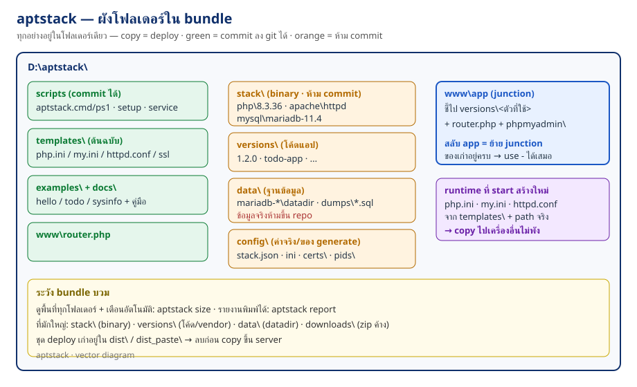

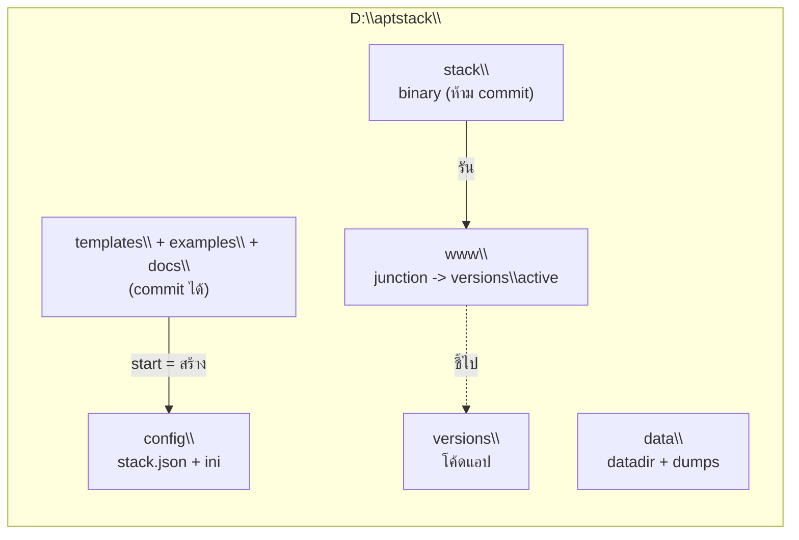

---

## 2. `aptstack start` — ไม่ใช่ "รอแบบเดา"

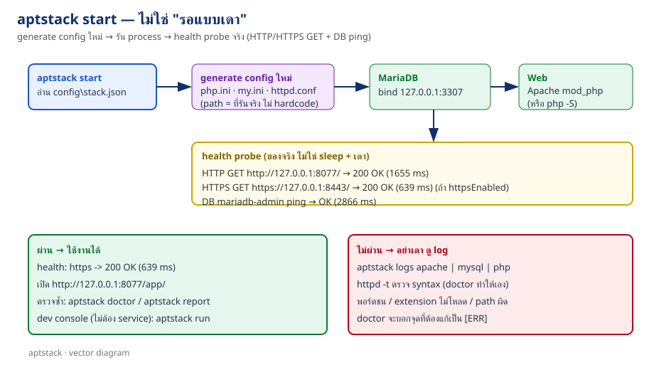

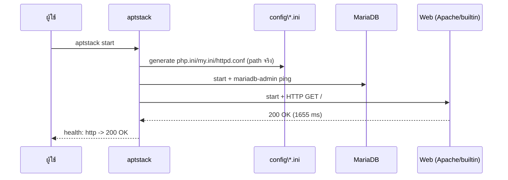

---

## 3. สลับเวอร์ชันแอป (junction + rollback)

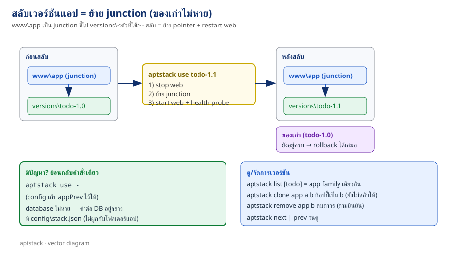

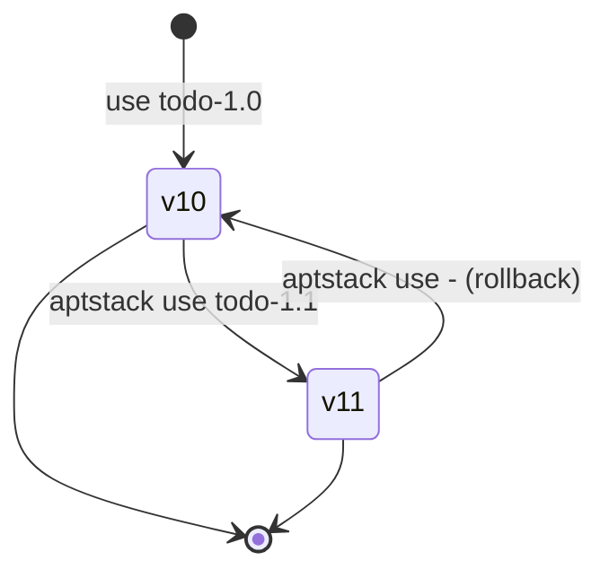

> หลักการ: `www\app` เป็น **junction** ชี้ไป `versions\<ตัวที่ active>`
> สลับ = ย้าย junction + restart web → ของเก่าอยู่ครบ → ย้อนกลับได้เสมอ

---

## 4. โยกฐานข้อมูลไป engine ใหม่ (migrate)

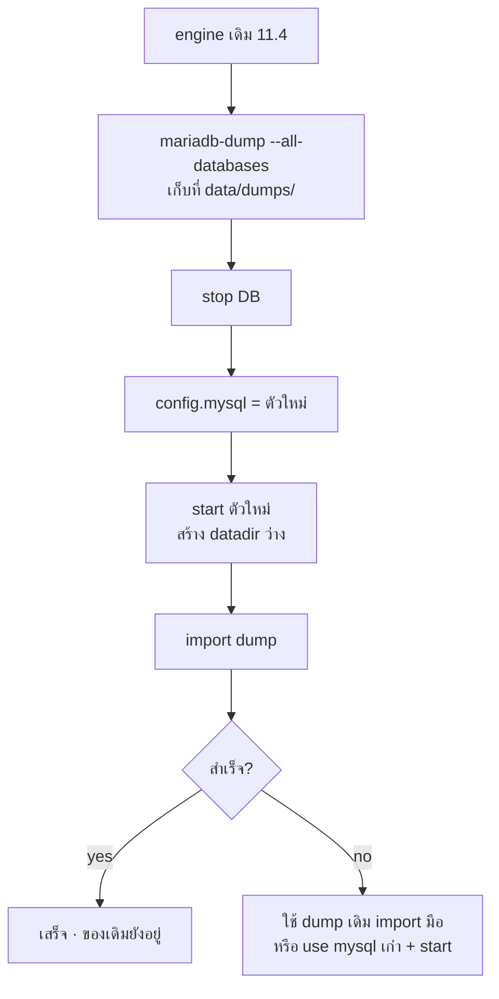

---

## 5. dev (notebook) vs production (server)

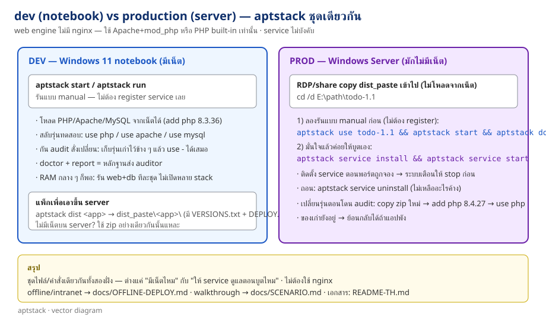

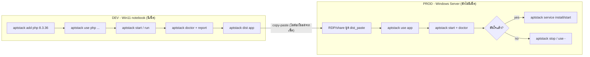

**สำคัญ**
- ไม่ใช้ nginx — มีแค่ **Apache + mod_php** หรือ **PHP built-in server** (`webMode`)
- **dev ไม่ต้อง register service** — ใช้ `start` / `run` ก็พอ
- **production รัน manual ก่อนได้** แล้วค่อย `service install` ทีหลัง

---

## 6. แพ็กเพื่อ copy-paste ขึ้น server (dist)

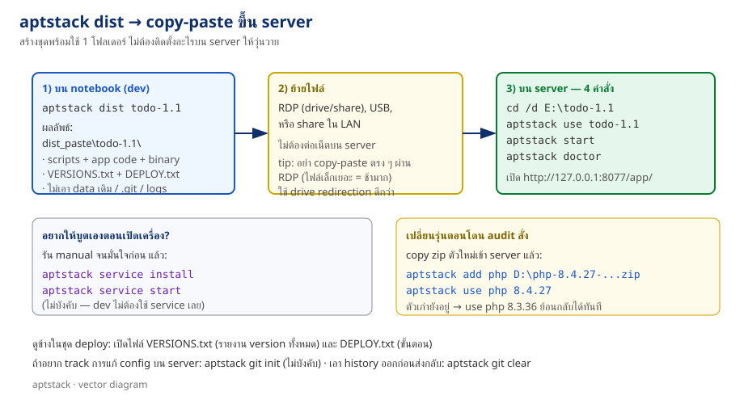

```mermaid
flowchart LR
  A[aptstack dist todo-1.1] --> B[dist_paste/todo-1.1/<br/>scripts + app + binary<br/>VERSIONS.txt + DEPLOY.txt]
  B --> C[RDP / USB / share]
  C --> D[cd เข้าโฟลเดอร์]
  D --> E[aptstack use todo-1.1]
  E --> F[aptstack start]
  F --> G[aptstack doctor]
  G --> H{ผ่าน?}
  H -- yes --> I[ใช้งานได้ / service install]
  H -- no --> J["aptstack logs apache&#124;mysql&#124;php"]
```

> ชุด deploy **ไม่เอา** `data\` เดิม, `.git`, `logs\` — server สร้างเองตอน start
> มี `VERSIONS.txt` บอก version ทั้งหมด + `DEPLOY.txt` ขั้นตอน

---

## 7. ดูไดอะแกรมเป็นไฟล์ (เปิดซูมได้)

| ไฟล์ | เนื้อหา |
|---|---|
| [bundle-layout.svg](diagrams/bundle-layout.svg) | ผังโฟลเดอร์ + อะไร commit ได้ + ระวัง bundle บวม |
| [lifecycle-start.svg](diagrams/lifecycle-start.svg) | start → generate conf → process → health probe |
| [version-switch.svg](diagrams/version-switch.svg) | junction สลับ + rollback + จัดการเวอร์ชัน |
| [dev-vs-prod.svg](diagrams/dev-vs-prod.svg) | notebook vs server · ไม่ใช้ nginx · service ไม่บังคับ |
| [deploy-dist.svg](diagrams/deploy-dist.svg) | dist → copy-paste → use/start/doctor |

**อัปเดตขนาด/พื้นที่:** `aptstack size` (CLI) · `aptstack report` (HTML พิมพ์ได้)
